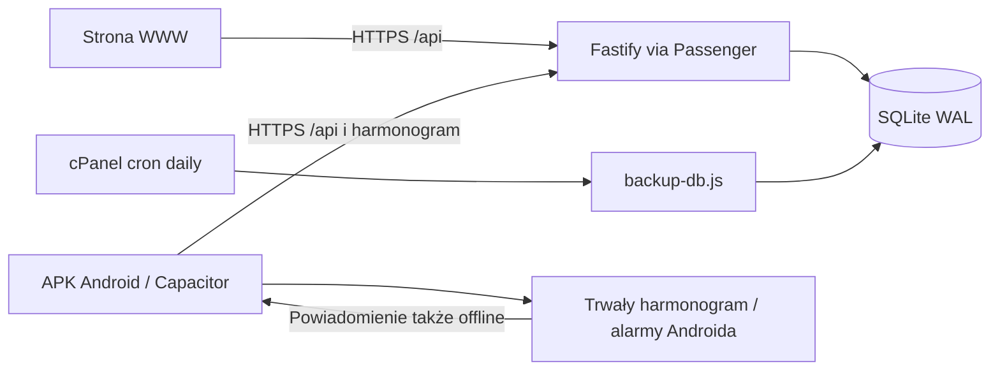

# Konwencje, hosting i model danych

Sekcje 2–5 przeniesione z planu bez zmiany zasad. Czytaj według zależności
zmiany, razem z [kontekstem i zasadami pracy](plan.md) oraz
[decyzjami](DECISIONS.md). Zachowano również docelowe modele przyszłych faz;
sam opis modelu nie oznacza jego implementacji. Rozbieżności opisuje
[raport porządkowania](DOKUMENTACJA_RAPORT.md).

## 2. Podjęte decyzje (nie zmieniać bez wpisu w DECISIONS.md)

- **Nazwa robocza** repo i pakietu: `rodzina`. Prefiks zmiennych środowiskowych: `RODZINA_`. Zmiana nazwy jest możliwa przed fazą 0.
- **Licencja:** dotychczasowa deklaracja MIT pozostaje bez zmian; nie planujemy publikacji projektu ani osobnej fazy wydania open source.
- **Runtime:** Node 24 . Node 20 nie jest już wspierany (koniec wsparcia: kwiecień 2026). W etapie pierwszego wdrożenia wybieramy najwyższą z tych wersji dostępną w cPanel - obecnie 24
- **Monorepo:** npm workspaces, bez Nx i bez Turborepo.
- **Skrypty wieloplatformowe (Windows, macOS, Linux):** w `package.json` nie używamy składni powłoki specyficznej dla systemu (np. `VAR=wartość komenda`). Środowisko przekazują skrypty Node, a równoległe uruchamianie zapewnia `concurrently`. Skrypty w `scripts/` to pliki `.mjs`, bez `bash`. Dotyczy to też `dev`, `release` i backupu.
- **Frontend:** React 19, Vite, TypeScript (strict), React Router (tryb biblioteki), TanStack Query, Mantine (+ `@mantine/dates`, `@mantine/notifications`, `@mantine/form`), Schedule-X (`@schedule-x/react`) do widoku kalendarza. Bez `vite-plugin-pwa`, Workbox i manifestu od 4.8; `legacy-sw.js` służy wyłącznie wycofaniu starych rejestracji i nie trafia do APK.
- **Backend:** Fastify, `fastify-type-provider-zod`, Drizzle ORM + SQLite, `@node-rs/argon2` (prebuilt, bez kompilacji), `rrule`, `date-fns` + `@date-fns/tz`, `@fastify/cookie`, `@fastify/rate-limit`, `@fastify/static`. Bez `web-push`, VAPID i wysyłki przypomnień od 4.9.
- **Sterownik SQLite:** `better-sqlite3`; `apps/api/src/db/client.ts` centralizuje otwieranie połączenia i ustawienia WAL oraz `busy_timeout`. Aplikacja świadomie zależy od synchronicznego SQLite przez Drizzle i `better-sqlite3`. Zależność obejmuje typy `BetterSQLite3Database` i natywnego połączenia, migrator sterownika, synchroniczne repozytoria i serwisy, transakcje (w tym `immediate` w idempotencji i limitach logowania), bezpośrednie SQL, backup `VACUUM INTO` oraz pakowanie i instalację gotowych binariów natywnych. Zamiana na `@libsql/client` wymaga osobnego projektu i zmian w wielu miejscach. Adapter wprowadzamy dopiero przy konkretnej potrzebie migracji, po sprawdzeniu modelu transakcyjnego drugiego klienta; ukrycie typów za interfejsem nie zapewnia zgodności zapisów synchronicznych i asynchronicznych. Przyszła migracja musi potwierdzić atomowość mutacji wraz z odpowiedzią idempotentną, migracje schematu i spójność backupu. Korektę wcześniejszego założenia zapisano w [DECISIONS.md](DECISIONS.md).
- **Wspólne typy:** `packages/shared` ze schematami zod. Front i API importują te same schematy.
- **Synchronizacja:** bez WebSocketów. TanStack Query z `refetchOnWindowFocus`, `refetchInterval: 20000` na aktywnych widokach i optymistycznymi mutacjami. Konflikty rozstrzyga reguła last-write-wins.
- **Android od fazy 4:** Capacitor, lokalne pliki wspólnego frontendu, zdalne API na vh.pl i systemowe alarmy lokalne. Wznowienie aplikacji i powrót sieci odświeżają dane oraz harmonogram. Brak gwarancji odświeżania przy zamkniętym APK; szczegóły i ograniczenia offline opisuje faza 4. Odczyt harmonogramu sprawdza uprawnienia na serwerze, a zapisany alarm offline nie wykonuje ponownej kontroli online.
- **Testy:** Vitest (api, shared, web), Testing Library dla komponentów, Playwright (tylko headless) dla smoke e2e od fazy 1.
- **Format daty i czasu:**
  - Momenty w czasie (`created_at`, `next_fire_at` itp.) to integer ms UTC.
  - Daty i godziny wydarzeń to lokalny czas ściany w strefie rodziny: `start_date` jako `YYYY-MM-DD` i `start_time` jako `HH:mm` lub null dla całodniowych.
  - Przeliczenie na UTC wyłącznie w `packages/shared/src/time.ts`.
- **ID:** `crypto.randomUUID()` jako text.
- **Przypomnienia są wspólne dla modułów.** Jedna tabela `reminders` i jeden kontrakt `/api/reminders/schedule` dla APK. Źródło przypomnienia to dokładnie jedno z pól: `event_id`, `task_id` (od fazy 7) albo `document_id` (od fazy 8). Serwer wyznacza odbiorców i konkretne terminy; APK zapisuje alarmy systemowe. Treść ma bezwzględną datę, a przyszłe prywatne zadania wyłącznie ogólny komunikat. Nie przywracamy joba wysyłki.
- **Odbiorcy przypomnień (`audience`)**, z jedną funkcją `resolveRecipients(reminder, source)` w API:
  - `participants`: uczestnicy wydarzenia. Gdy wydarzenie nie ma uczestników, przypomnienie trafia do twórcy. Dotyczy tylko wydarzeń.
  - `family`: wszyscy domownicy, łącznie z dziećmi.
  - `adults`: domownicy z rolą `admin` lub `member`.
  - `owner`: osoba odpowiedzialna za źródło. Dla wydarzenia to twórca, dla zadania osoba przypisana albo (gdy jej brak) właściciel listy, dla dokumentu posiadacz albo (gdy jego brak) twórca.
  - `list_members` (od fazy 7): właściciel i członkowie listy zadań. Dotyczy tylko zadań.
  - `user`: jedna konkretna osoba wskazana w `reminders.user_id`. W UI to opcja "tylko ja", która ustawia `user_id` na osobę dodającą przypomnienie. Dostępna dla wszystkich źródeł.
- **Dozwolone wartości `audience` per źródło:**
  - wydarzenia: `participants`, `family`, `adults`, `owner`, `user`;
  - zadania: `owner`, `list_members`, `user`. **Nigdy `family` ani `adults`**, bo listy zadań mogą być prywatne;
  - dokumenty: `family`, `adults`, `owner`, `user`.
- **Kontrola dostępu przy odczycie harmonogramu.** `resolveRecipients` odfiltrowuje osoby, które w chwili synchronizacji nie widzą źródła. Członek, który opuścił listę zadań, nie otrzyma jej wpisów, także "tylko ja"; udana synchronizacja anuluje wcześniejsze alarmy. Telefon offline nie pozna cofnięcia dostępu, dlatego prywatne zadania mają ogólny payload i wymagają autoryzacji online przy otwarciu.
- **Awaryjny odbiorca.** Jeśli po odfiltrowaniu lista odbiorców jest pusta (np. twórca albo uczestnicy zostali usunięci), przypomnienie trafia do `adults`. Wyjątek stanowią zadania: pusta lista odbiorców oznacza brak wpisu w harmonogramie, bez awaryjnego `adults`.
- **Przypomnienia wspólne i osobiste:**
  - Wspólne, czyli z `audience` innym niż `user`, są częścią edycji źródła i zapisuje je ten, kto ma prawo edytować źródło.
  - Osobiste (`audience=user`) mają osobne endpointy (faza 2) i może je ustawić każdy, kto widzi źródło, ale tylko dla siebie.
  - Zapis źródła nigdy nie zmienia ani nie usuwa cudzych przypomnień osobistych.
- **Przypomnienia po zmianie źródła.** Każda zmiana terminu, odhaczenie lub odznaczenie zadania, odnowienie dokumentu i edycja serii przeliczają `next_fire_at` przez `computeNextFireAt`. Ukończone zadanie ma `next_fire_at = null`, a po ponownym otwarciu przypomnienia są przeliczane od nowa.
- **Dwa typy przypomnień:**
  - `offset`: "N jednostek przed terminem", zapisane jako `offset_value` + `offset_unit` (`minute` | `hour` | `day` | `week` | `month`). Jednostki `day`, `week` i `month` liczymy **kalendarzowo w czasie lokalnym**: ta sama godzina lokalna N dni, tygodni albo miesięcy wcześniej. Dla terminów bez godziny bazą jest 09:00. Takie przypomnienie zawsze podąża za terminem, także po zmianie daty i po "Odnowiono".
  - `absolute`: konkretna data i godzina wybrana przez użytkownika w kalendarzu. Nie podąża za terminem. Jeśli po zmianie terminu znajdzie się w przeszłości, `next_fire_at = null`, a UI pokazuje je jako "nieaktualne" z opcją usunięcia.
  - UI tworzy `offset` dla wszystkich presetów i dla "N dni/tygodni/miesięcy przed", a `absolute` wyłącznie dla opcji "w wybranym dniu".
- **Usuwanie danych:**
  - Usunięcie wydarzenia, zadania, listy zadań albo dokumentu usuwa kaskadowo jego przypomnienia (FK `ON DELETE CASCADE`). Podobnie uczestników, wyjątki, pozycje i składniki.
  - Usunięcie domownika usuwa jego sesje, subskrypcje push, członkostwa w listach zadań, przypomnienia z `audience=user` wskazujące na niego i jego prywatne listy zadań. Listy udostępnione przechodzą na pierwszego członka z ustawieniem `is_default=false`, a gdy członków brak, są usuwane.
  - Przy usuwanym domowniku jego przypisania do zadań i bycie posiadaczem dokumentu zmieniają się na `null`, a jego udział w wydarzeniach jest usuwany.
  - Treści, które utworzył (`created_by`), zostają, a w UI wyświetlają się jako "były domownik".
  - **Klucze obce do `users`:** wszystkie kolumny wskazujące osobę, która coś zrobiła albo za coś odpowiada (`created_by` we wszystkich tabelach, `checked_by`, `done_by`, `assignee_id`, `holder_user_id`), są nullable z `ON DELETE SET NULL`. W UI `null` wyświetla się jako "były domownik". Kaskadowo (`ON DELETE CASCADE`) usuwane są tylko: `sessions`, `password_resets`, `event_participants`, `task_list_members` i `reminders` z `audience=user`. Listy zadań obsługuje reguła przeniesienia opisana wyżej, wykonywana w serwisie przed usunięciem użytkownika.

## 3. Ograniczenia hostingu i jak je obchodzimy

- **Passenger usypia proces.** Brak schedulera w pamięci; jedyny job okresowy to backup przez **cron z cPanel**. Lokalnie: `npm run job:backup` po buildzie. Przypomnienia realizuje APK z trwałego harmonogramu, bez crona wysyłki.
- **Zmienne środowiskowe** ustawione w panelu aplikacji Node nie są widoczne dla crona. Dlatego cała konfiguracja jest w pliku `~/rodzina-data/.env`. Serwer wczytuje go przez `process.loadEnvFile(process.env.RODZINA_ENV_FILE ?? '<home>/rodzina-data/.env')` w `server.cjs`, a joby przez flagę `node --env-file=...`. Lokalnie używamy `apps/api/.env`.
- **ESM pod Passengerem.** Plik startowy to `server.cjs` (CommonJS), który robi `import('./dist/server.js')`. Fastify nasłuchuje na `process.env.PORT ?? 3000`.
- **Ścieżki w paczce release.** Wszystkie ścieżki do plików (frontend, migracje) są liczone względem katalogu `server.cjs`, a nie względem repo. Frontend w paczce leży w `public/` (zmienna `RODZINA_WEB_DIR`, domyślnie `./public`), a migracje w `drizzle/`. Lokalnie `server.cjs` leży w `apps/api/`, więc `apps/api/.env.example` zawiera `RODZINA_WEB_DIR=../web/dist`.
- **Moduły ES.** Produkcyjny `package.json` w paczce ma `"type": "module"`, żeby `dist/*.js` ładowały się jako ESM. `server.cjs` dzięki rozszerzeniu pozostaje CommonJS.
- **Dwa procesy na jednej bazie** (serwer i cron). SQLite działa w trybie `journal_mode=WAL` z `busy_timeout=5000`.
- **HTTPS** zapewnia AutoSSL w cPanel (etap pierwszego wdrożenia). Aplikacja w produkcji ustawia cookie `Secure`, a za proxy Passengera ufa nagłówkom `X-Forwarded-`* (`trustProxy: true`).
- **Brak wysyłki e-maili w MVP.** Zaproszenia i reset hasła działają przez link generowany w aplikacji, który admin przekazuje np. przez komunikator.



## 4. Struktura repo (docelowa)

```text
rodzina/
  AGENTS.md                 # instrukcje dla agentów (stack, komendy, konwencje)
  README.md                 # PL; rozwijany wraz z funkcjami i instrukcją Androida
  capacitor.config.ts       # konfiguracja wspólnego frontendu i połączenia z API, od fazy 4
  android/                  # projekt Android, Gradle i kod natywny; bez sekretów i keystore
  docs/
    plan.md                 # ten dokument
    DECISIONS.md
    DEVELOPMENT.md          # uruchomienie lokalne, testy na Androidzie
    DEPLOY.md               # instrukcja cPanel krok po kroku (PL), rozwijana w każdej fazie
  package.json              # workspaces + skrypty root
  tsconfig.base.json
  eslint.config.mjs
  .prettierrc.json          # 120 znaków, single quotes, trailing commas
  .github/workflows/ci.yml
  scripts/
    build-release.mjs       # cross-platform, tworzy release.zip
    smoke-release.mjs       # rozpakowuje zip, instaluje prod deps, startuje server.cjs, sprawdza health
  packages/shared/src/
    schemas/                # zod: auth, events, reminders, shopping, meals, tasks, documents
    time.ts                 # strefy czasu, rozwijanie RRULE, liczenie przypomnień
    index.ts
  apps/api/
    server.cjs              # plik startowy Passengera
    .env.example
    drizzle.config.ts
    drizzle/                # wygenerowane migracje (commitowane)
    src/
      server.ts             # bootstrap: config, db, migracje, app.listen
      app.ts                # buildApp() - używane też w testach
      config.ts             # walidacja env przez zod
      db/schema.ts, db/client.ts
      plugins/              # auth (sesja -> request.user), errors, static
      modules/<moduł>/      # routes.ts, service.ts, repository.ts, *.test.ts
      jobs/backup-db.ts
  apps/web/
    index.html
    vite.config.ts          # proxy /api -> :3000 w dev, changeOrigin: false
    public/icons/           # 192, 512, maskable
    src/
      main.tsx, router.tsx, retireLegacyPwa.ts
      api/                  # klient fetch + hooki TanStack Query per moduł
      i18n/pl.ts            # wszystkie teksty UI w jednym obiekcie
      features/<moduł>/     # strony i komponenty
      components/           # wspólne (AppShell, BottomNav, EmptyState)
```

### Skrypty root (`package.json`)

- `dev`: równolegle API (`tsx watch --env-file=apps/api/.env apps/api/src/server.ts`, port 3000) i Vite (port 5173 z proxy `/api`)
- `start`: uruchamia zbudowaną aplikację produkcyjnie (Node wczytuje `apps/api/.env` i uruchamia `apps/api/server.cjs` w trybie produkcyjnym; port 3000, API i frontend razem). Używa tego samego portu co API w `dev`, więc oba nie mogą działać jednocześnie, co trzeba opisać w `DEVELOPMENT.md`.
- `job:backup`: jednorazowe uruchomienie backupu po buildzie
- `build`: shared, web, api (bundling przez `tsup`, natywne zależności jako external)
- `lint`, `format`, `format:check`, `typecheck`, `test`, `test:e2e` (Playwright headless)
- `db:generate` (drizzle-kit generate), `db:migrate`
- `release`: `node scripts/build-release.mjs`
- `release:smoke`: `node scripts/smoke-release.mjs`
- `android:debug`, `android:release`, `android:release:interactive`, `android:package`: osobne budowanie, podpisywanie i pakowanie APK; szczegóły w DEVELOPMENT i DEPLOY

### Konwencje API

- Prefiks `/api`, JSON, walidacja zod na wejściu i wyjściu.
- Błędy mają postać `{ "error": { "code": "VALIDATION_ERROR" | "UNAUTHORIZED" | "FORBIDDEN" | "NOT_FOUND" | "CONFLICT" | "RATE_LIMITED", "message": "<po polsku, do pokazania w UI>" } }`.
- Każdy endpoint wymaga sesji, z wyjątkiem: `GET /api/health`, `POST /api/auth/register-family`, `POST /api/auth/login`, `POST /api/auth/login-child`, `GET /api/auth/family-members`, `GET /api/invitations/:token`, `POST /api/invitations/:token/accept` i `POST /api/auth/reset-password`.
- `family_id` **zawsze** pochodzi z sesji, nigdy z body ani z URL. Repozytoria przyjmują `familyId` jako pierwszy argument.
- Mutacje wymagają `Content-Type: application/json`, a nagłówek `Origin` musi mieć ten sam host co host żądania (ochrona CSRF razem z cookie `SameSite=Lax`). Nie porównujemy z `RODZINA_PUBLIC_URL`, żeby działały zarówno `localhost:5173` (proxy Vite), jak i `localhost:3000`, a na serwerze subdomena. Szczegóły:
  - Host żądania bierzemy z `request.host` Fastify. Przy `trustProxy: true` uwzględnia on `X-Forwarded-Host` za Passengerem.
  - Proxy Vite w `vite.config.ts` **musi mieć `changeOrigin: false`**. Inaczej Vite podmieni `Host` na `localhost:3000` i każda mutacja w dev dostanie 403.
  - Test API: mutacja z obcym `Origin` dostaje 403, a z właściwym przechodzi.
- Każda encja domenowa (wydarzenie, pozycja zakupów, obiad, zadanie, dokument; w planowanej fazie 9 także kontakt i grupa kontaktów) ma `createdAt`, `updatedAt` i `createdBy`. Tabele pomocnicze (uczestnicy, składniki, członkostwa) nie muszą.

## 5. Model danych (całość)

- `families`: id, name, timezone (stała `Europe/Warsaw`, bez edycji w MVP), join_code (6 znaków, do logowania dzieci), created_at
- `users`: id, family_id, display_name, email (unique, nullable), password_hash (nullable), pin_hash (nullable), role (`admin` | `member` | `child`), color (hex), created_at, updated_at
- `sessions`: id (sha256 tokenu), user_id, expires_at, created_at, user_agent
- `invitations`: id, family_id, token_hash, role, created_by, expires_at (7 dni), used_at
- `password_resets`: id, user_id, token_hash, expires_at (24h), used_at
- `events`: id, family_id, title, description, location, start_date, start_time (nullable), duration_minutes (nullable dla całodniowych), date_precision (`day` | `month`), rrule (nullable, bez DTSTART), kind (`single` | `recurring` | `distant`), created_by, created_at, updated_at
- `event_participants`: event_id, user_id
- `event_exceptions`: id, event_id, original_date, is_cancelled, override_start_date, override_start_time, override_duration_minutes, override_title
- `reminders`: id, family_id, event_id (nullable), task_id (nullable, faza 7), document_id (nullable, faza 8), type (`offset` | `absolute`), offset_value (integer, nullable), offset_unit (`minute` | `hour` | `day` | `week` | `month`, nullable), remind_at (nullable, ms UTC, tylko dla `absolute`), audience (`participants` | `family` | `adults` | `owner` | `user`, od fazy 7 także `list_members`; znaczenie w sekcji 2), user_id (nullable, wymagane przy `audience=user`), created_by, next_fire_at (nullable), last_sent_at (nullable). Walidacja w serwisie: dokładnie jedno ze źródeł jest ustawione.
- Historyczna `push_subscriptions` została usunięta migracją 0013; nie należy do bieżącego modelu. Historyczne pola `next_fire_at` i `last_sent_at` w `reminders` pozostają dla zgodności, ale nie sterują dostarczaniem alarmów APK.
- `shopping_lists`: id, family_id, name, position, created_by, created_at, updated_at
- `shopping_items`: id, list_id, name, quantity (text), category, is_checked, checked_by, checked_at, position, created_by, created_at, updated_at
- `shopping_history`: family_id, name_normalized, display_name, category, use_count, last_used_at (do podpowiedzi)
- `shopping_operations`: user_id, id, fingerprint, response, status (atomowe ponawianie zapisów zakupów po utracie odpowiedzi; migracja 0015, krok 5.3)
- `meals`: id, family_id, date, slot (`dinner`, enum rozszerzalny), title, notes, created_by, updated_at
- `meal_ingredients`: id, meal_id, name, quantity
- `task_lists` (faza 7): id, family_id, owner_id, name, is_default, position, created_at, updated_at
- `task_list_members` (faza 7): list_id, user_id
- `tasks` (faza 7): id, list_id, title, notes, due_date (nullable), due_time (nullable), assignee_id (nullable), is_done, done_by, done_at, position, created_by, created_at, updated_at
- `documents` (faza 8): id, family_id, type (`id_card` | `passport` | `car_insurance` | `car_inspection` | `car_guarantee_inspection` | `home_insurance` | `rental_agreement` | `other`), label, holder_user_id (nullable), vehicle_label (nullable), expires_on (`YYYY-MM-DD`), notes, created_by, created_at, updated_at

### Model Kontaktów — faza 9, krok 9.1

- `contact_groups`: id, family_id, name, is_default, created_by, created_at, updated_at. Jedna grupa domyślna na rodzinę, początkowo „Inne”; nie można jej usunąć. Pozostałe grupy początkowe: Rodzina, Znajomi, Praca.
- `contacts`: id, family_id, group_id, name, address (nullable, tekst wielowierszowy), phone (nullable), relationship (nullable), created_by, created_at, updated_at. Każdy kontakt należy do jednej grupy tej samej rodziny; usunięcie grupy przenosi kontakty do grupy domyślnej w jednej transakcji, bez kaskady usuwania kontaktów.
- Cała rodzina odczytuje dane, role `admin` i `member` wykonują mutacje. Brak powiązań z kontami domowników, przypomnień i synchronizacji książki telefonu.
- Wspólne typy `Contact` i `ContactGroup`, schematy Zod oraz API opisuje [faza 9 w planie](plan.md#faza-9---kontakty). Model i API dodano w kroku 9.1; stan weryfikacji jest w planie. Krok 9.3 dodaje snapshot `rodzina:contacts:v1` do odczytu offline per rodzina i użytkownik, z integracją rejestru magazynów konta i bez kolejki zmian. Snapshot zawiera kompletną odpowiedź API i czas pobrania w ms UTC. Zmiana generacji magazynu unieważnia spóźnione odpowiedzi; zdarzenie innej karty czyści pamięć bez usuwania jej nowego konta.
